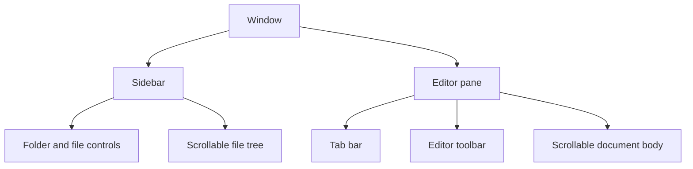

# GPUI Editor Design Principles

## Minimalism

Keep the focus on the document. By default, show only the controls and information needed for the current task.

- **Put the document first.** Let users read and edit in the same area without switching to a separate preview.
- **Make common actions easy to find.** Keep opening, creating, and saving documents easy to find. Put less common insert and edit actions in the **More tools** menu or next to the item they affect.
- **Use clear icons or short labels.** Prefer an icon when it makes the action clear on its own. If users would have to guess, use a short label such as **Open Folder…**.
- **Leave room to read and click.** Use enough spacing between lines of text and between interface elements to make them easy to read and use. Do not reduce spacing just to fit more on screen.
- **Keep important status visible.** Mark unsaved tabs and show actionable errors near the document. Do not reserve a permanent bar for status.

## Window layout

- Use two full-height columns. Put the file explorer on the left and give the editor the remaining width. Separate the columns with one subtle divider. Do not add a title row, global toolbar, workspace information bar, or bottom status bar.
- Keep the sidebar controls on top and the tree directly below them. Use chevrons and indentation for folders. Highlight the active file. Resize the sidebar by dragging the divider. Hiding the sidebar must retain the tree state and selected document; show the reopen control in the tab row.
- Start the editor pane with horizontally scrollable tabs, followed by one row of editing tools. Use an accent to identify the selected tab and a marker for unsaved edits. Keep secondary tools in **More tools** and label icon-only controls on hover. At narrow widths, scroll the tool row rather than wrapping it.
- Give the document the remaining height. Wrap prose to the available width. Keep scrolling independent of the sidebar and top controls. Wide read-only previews can scroll horizontally within the document viewport.
- Use colors from the window's appearance. Keep the sidebar slightly tinted, the editor surface neutral, and the accent consistent between selection states.
- Keep macOS close, minimize, and zoom controls in the existing top row. Leave an unobstructed drag area in that row. The controls must not obscure sidebar buttons or tabs.

Design check: Before adding a control that is always visible, identify the common task that needs it. If it is useful only in a specific situation, show it only in that situation or put it in a menu.
