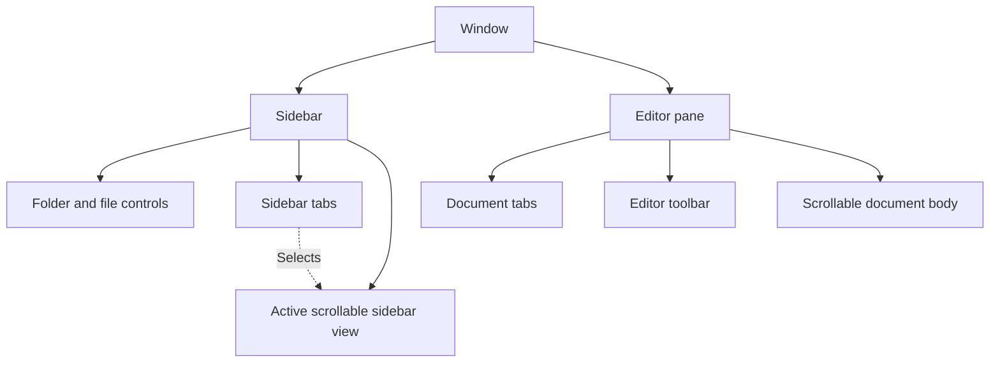

# GPUI Editor Design Principles

## Minimalism

Keep the focus on the document. By default, show only the controls and information needed for the current task.

- **Put the document first.** Let users read and edit in the same area without switching to a separate preview.
- **Make common actions easy to find.** Keep opening, creating, and saving documents easy to find. Put less common insert and edit actions in the **More tools** menu or next to the item they affect.
- **Use clear icons or short labels.** Prefer an icon when it makes the action clear on its own. If users would have to guess, use a short label such as **Open Folder…**.
- **Leave room to read and click.** Use enough spacing between lines of text and between interface elements to make them easy to read and use. Do not reduce spacing just to fit more on screen.
- **Keep important status visible.** Mark unsaved tabs and show actionable errors near the document. Do not reserve a permanent bar for status.

## Window layout

- Use two full-height columns. Put the sidebar on the left and give the editor the remaining width. Separate the columns with one subtle divider. Do not add a title row, global toolbar, workspace information bar, or bottom status bar.
- Keep the sidebar toolbar and tab row fixed above the active view. Start with **Tree**, **Recent**, **Pins**, **Outline**, and **Search** in that order, with **Tree** selected. Show one view at a time and give each view its own scroll position. Use the accent to mark selection. At the minimum sidebar width of `184 px`, keep all five tabs available as icons with name tooltips; show text when space allows. Show a prompt when the active view has no content.
- Show an insertion line when dragging a sidebar tab. Change the order only on drop in the sidebar tab row. Preserve the active sidebar view, and do not switch, save, or reorder document tabs.
- In **Tree**, use chevrons and indentation for folders and highlight the active file. Show the pin or unpin control on Markdown rows only on hover or keyboard focus; apply the same rule to the remove control in **Pins**. Using those controls must not open, close, or delete a document.
- Resize the sidebar by dragging the divider. Hiding the sidebar must retain its width, selected view, tab order, view state, and the selected document. Show the reopen control in the document tab row.
- Start the editor pane with horizontally scrollable tabs, followed by one row of editing tools. Use an accent to identify the selected tab and a marker for unsaved edits. Keep secondary tools in **More tools** and label icon-only controls on hover. At narrow widths, scroll the tool row rather than wrapping it.
- Reorder document tabs only when a document tab is dropped in its own row. Show an insertion line and scroll the row near its edges when more tabs are available. Cancel a drop outside the row; keep sidebar and document drags separate. Move tabs by stable identity without replacing their editors, switching the selected document, saving, or changing drafts, selections, or undo history. Record the new order of saved workspace tabs on normal exit using the existing session format.
- When editing a rendered item's source, show a short type label such as `<mermaid>` above the editable text and a subtle border around both. Remove the label and border when the item returns to preview. Do not include them in the Markdown.
- Give the document the remaining height. Wrap prose to the available width. Keep scrolling independent of the sidebar and top controls. Wide read-only previews can scroll horizontally within the document viewport.
- Use colors from the window's appearance. Keep the sidebar slightly tinted, the editor surface neutral, and the accent consistent between selection states.
- Keep macOS close, minimize, and zoom controls in the existing top row. Leave an unobstructed drag area in that row. The controls must not obscure sidebar buttons or tabs.

## Command Palette

- Open the Command Palette with `Cmd-P` as a temporary overlay, not a permanent toolbar. Focus its plain-text search field, with text selection, paste, and input method support.
- Filter **Open Folder…**, **New note**, **Save**, and **Toggle Sidebar** by command name without matching case. Show a clear empty state. Let the arrow keys move between commands and `Enter` run the selected available command. While an input method is composing text, do not use its keys to navigate or run commands.
- Use the same actions and availability rules as the toolbar and menus. Keep unavailable actions from running, including **Save** when there is no document. Opening the palette must not change the document. `Esc` dismisses it without running a command and restores the previous focus.

Design check: Before adding a control that is always visible, identify the common task that needs it. If it is useful only in a specific situation, show it only in that situation or put it in a menu.
