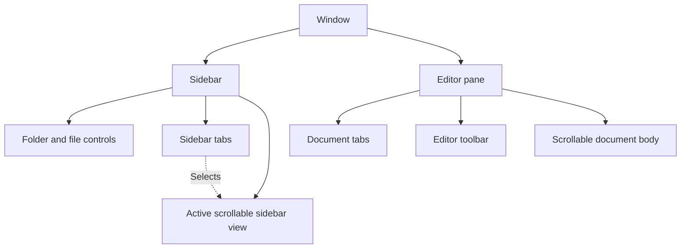

# GPUI Editor Design Principles

## Minimalism

Keep the focus on the document. By default, show only the controls and information needed for the current task.

- **Put the document first.** Let users read and edit in the same area without switching to a separate preview.
- **Make common actions easy to find.** Keep opening, creating, and saving documents easy to find. Put less common insert and edit actions in the **More tools** menu or next to the item they affect.
- **Use clear icons or short labels.** Prefer an icon when it makes the action clear on its own. If users would have to guess, use a short label such as **Open Folder…**.
- **Leave room to read and click.** Use enough spacing between lines of text and between interface elements to make them easy to read and use. Do not reduce spacing just to fit more on screen.
- **Keep important status visible.** Mark unsaved tabs and show actionable errors near the document. Do not reserve a permanent bar for status.

## Window layout

- Use two full-height columns. Put the sidebar on the left and give the editor the remaining width. Separate the columns with one subtle divider. Do not add a title row, global toolbar, workspace information bar, or bottom status bar.
- Keep the sidebar toolbar and tab row fixed above the active view. Start with **Tree**, **Recent**, **Pins**, **Outline**, and **Search** in that order, with **Tree** selected. Show one view at a time and give each view its own scroll position. Use the accent to mark selection. At the minimum sidebar width of `184 px`, keep all five tabs available as icons with name tooltips; show text when space allows. Show a prompt when the active view has no content.
- Show an insertion line when dragging a sidebar tab. Change the order only on drop in the sidebar tab row. Preserve the active sidebar view, and do not switch, save, or reorder document tabs.
- In **Tree**, use chevrons and indentation for folders and highlight the active file. Show the pin or unpin control on file rows only on hover or keyboard focus; apply the same rule to the remove control in **Pins**. Using those controls must not open, close, or delete a document.
- Resize the sidebar by dragging the divider. Hiding the sidebar must retain its width, selected view, tab order, view state, and the selected document. Show the reopen control in the document tab row.
- Start the editor pane with horizontally scrollable tabs, followed by one row of editing tools. Use an accent to identify the selected tab and a marker for unsaved edits. Keep secondary tools in **More tools** and label icon-only controls on hover. At narrow widths, scroll the tool row rather than wrapping it.
- Show Markdown tools only in Markdown tabs. Display plain text in a monospaced font. For recognized code and configuration files, use syntax colors that match the editor appearance. Do not change the text or open a separate preview.
- Reorder document tabs only when a document tab is dropped in its own row. Show an insertion line and scroll the row near its edges when more tabs are available. Cancel a drop outside the row; keep sidebar and document drags separate. Move tabs by stable identity without replacing their editors, switching the selected document, saving, or changing drafts, selections, or undo history. Record the new order of saved workspace tabs on normal exit using the existing session format.
- When editing a rendered item's source, show a short type label such as `<mermaid>` above the editable text and a subtle border around both. Remove the label and border when the item returns to preview. Do not include them in the Markdown.
- Keep inline code in the paragraph. Use a monospaced font. Show its Markdown delimiters when the caret enters the span, without opening a source frame.
- Give the document the remaining height. Wrap prose to the available width. Keep scrolling independent of the sidebar and top controls. Wide read-only previews can scroll horizontally within the document viewport. When a native extension enables scroll-past-end, add space below the document without adding lines or changing the selection.
- Use colors from the window's appearance by default. An installed editor theme can override the editor's colors without changing the window. Keep the sidebar slightly tinted, the editor surface neutral, and the accent consistent between selection states.
- Keep macOS close, minimize, and zoom controls in the existing top row. Leave an unobstructed drag area in that row. The controls must not obscure sidebar buttons or tabs. On Windows, use the native title bar.
- Show a configured placeholder only in an empty document. It does not change document text, caret hits, or scroll bounds.

## Selection History

- Use `Cmd-U` and `Cmd-Shift-U` to undo and redo pointer or keyboard selection changes. Keep text unchanged when a selection step is available. Otherwise use text undo or redo. Do not run these commands during input method composition.
- When the host installs native selection drawing, use its caret blink period in the focused editor of the active window. A zero period keeps the caret visible. Draw a caret at each nonempty selection head only when the installed options permit it. Keep selection backgrounds and input method geometry unchanged.

## Brackets in Source Editing

- In an active YAML front matter, Mermaid, or code draft section, insert bracket pairs, skip tracked closing brackets, and delete pairs through the Markdown edit rules. Keep generated fence separators outside the editable body. Each accepted pair edit is one undo step.
- Mark brackets at each eligible empty caret in the active source body while the editor has focus. Do not match across section boundaries. If the installed options disable after-caret matching, do not mark a token that starts at or after the caret. In plain source and supported syntax-aware drafts, use installed plain pairs and measure the scan limit in UTF-16 units at logical line chunk boundaries. Give grammar-marked brackets priority and apply the limit only to plain scans. If the host installs a bracket renderer, draw its matching and nonmatching marks only in the active body. Reject the returned marks if any range crosses the body or splits a UTF-8 character. Do not pair or mark brackets during input method composition.
- In an editable HTML or XML fence, match tag names and delimiters with its syntax. Use each mounted HTML script or style tree for bracket feedback within its own region. At a mount boundary, give the probe at the start to the child only when scanning forward. Give the probe at the end to the child only when scanning backward. In C, C++, Go, Python, Rust, Java, CSS, JavaScript, TypeScript, JSX, and TSX, use syntax so a bracket in a string or comment does not close a code delimiter. In the JavaScript family, match marked type angles, template interpolation, and JSX punctuation at their token ranges. Use C, C++, Go, HTML, Java, JavaScript-family, Rust, and XML syntax for quote input. In HTML, use the mounted JavaScript tree inside an eligible script body or event attribute.

- In an HTML, XML, JSX, TSX, Angular, Vue, Jinja, Liquid, or PHP draft, completing a tag can insert its closing tag. In a Jinja or Liquid draft, typing `%` between `{}` inserts `` and puts the caret between the two percent signs. Keep the edit inside the fence body and record it as one undo step.

## Completion in Source Editing

- In an editable draft with a native completion source, offer completions after typing or when the user presses `Ctrl-Space`. Use the source for the language at the caret, including embedded HTML, JavaScript, and CSS. Limit edits to the code body. Do not change either fence, read-only previews, or nearby prose.
  - In an SQL draft, check the registered schema for that dialect before the stock keyword source. In an XML draft, use the installed schema with the existing tag and entity source. Discard stale results when a registration changes. Do not query a database or look up an external schema.
- On macOS, a host can request plain text choices from an attached trusted language server. Do not change the native completion list. Apply only the item the host chooses, after checking that all edits stay in the current editable fence and preserve protected Markdown. Apply it in one undo step. Do not run server commands or interpret documentation.
- Show available options next to the visible caret. Use the arrow keys or page keys to select an option. Click an option or press `Enter` to insert it in one undo step. Close the list with `Esc`. Close the list on a change of focus, cursor movement, or input method composition.
- When the source or selected option specifies a commit character, apply the option before inserting that character through the normal input path. A rejected completion does not consume the key.
- After inserting a snippet, select the first field. Use `Tab` and `Shift-Tab` to move between fields. Show linked selections and apply their edits together. End the session on `Esc`, on a selection outside the active field, or before input method composition.
- Use `Shift-Option-M` to turn Tab focus mode on or off. In this mode, `Tab` and `Shift-Tab` move focus to another control instead of moving to a snippet field. An unhandled `Esc` lets Tab move focus for two seconds. Another non-modifier key ends this temporary mode.

## Diagnostics in Source Editing

Language server actions in this section are available on macOS.

- Run configured diagnostic providers for an editable code fence. With no configured provider, run stock JSON diagnostics after typing stops. Mark problems in the fence body. On hover, show the first message that passes the tooltip filters. The filters do not change markers or panel entries. Do not show marks or apply fixes in the fence markers, read-only previews, or nearby prose. Hide results during input method composition and discard stale results.
- Open the temporary Diagnostics panel from **More tools** or with `Cmd-Shift-M`. Use `F8` and `Shift-F8` to move between diagnostics. In the focused editor, show the first filtered message at the destination without waiting for the pointer. Close that message on `Esc`, an edit, a move outside the selected diagnostic, or loss of focus. Select a panel row to reveal its source. Close the panel with `Esc` or **Close** and return focus to the editor.
- When a host attaches a trusted language server, show a requested hover only at a visible, editable source position. Show bounded plain text. Do not interpret markup or activate links. Hide the hover on an edit, loss of focus, `Esc`, or input method composition.
- If the host enables push diagnostics, accept only bounded batches for the attached draft and its current synchronized version. Mark problems in the active editable code body. Show server messages as plain text on hover while the editor is focused in the active window. Do not add them to local diagnostic navigation or offer server actions.
- Show signature help at a visible, editable caret. Use `Cmd-Shift-Space` to request it. A character accepted through normal typing can request or refresh it. Use `Cmd-Shift-Up` and `Cmd-Shift-Down` to select an overload without changing the text or selection. Show only bounded plain text. Hide the result on an edit, a selection change, loss of focus, `Esc`, or input method composition.
- A trusted host can show one bounded literal tooltip at a visible position in the current editable code body. If it requests an arrow, attach the arrow to the measured anchor. Do not add an arrow to stock diagnostics, completion, or language server overlays. Do not change the caret, focus, or scroll to show the tooltip. Hide it when its anchor is offscreen. Dismiss it when the body becomes inactive, on edit, blur, `Esc`, or input method composition.
- Show explicitly requested references from the attached draft in a temporary panel below the document. Show line numbers and plain text. Click a row, or select it with the arrow keys and press `Enter`, to reveal it without editing the source. Close with `Esc` or **Close**. Do not open files or take focus from another control.
- Reveal a trusted language server definition, declaration, type definition, or implementation only after an explicit host request and apply call. Accept a current target only inside the same editable code fence. Do not open a file, take focus, or add an undo step.
- Apply a trusted language server formatting result only after an explicit host request and apply call. Reject the entire result if it is stale, touches protected Markdown, or changes a fence. Apply a valid batch in one undo step. Do not add a default formatting shortcut.
- Apply a trusted language server rename only after an explicit host request and apply call. Accept the complete batch only if it is current and stays inside the same editable fence without changing protected Markdown. Apply it in one undo step. Do not open other files, prompt for a name, or install a default shortcut.

## Collaboration in Source Editing

- A host can read pending text updates and submit a text-only authority batch at the synchronized version. Check each outgoing update and each received update, including echoes. Permit edits only in an existing unclosed code draft at the end of the document. Do not change the opening fence, protected Markdown, focus, or scroll position. Map the caret and undo through accepted edits. Do not send or receive updates while marked text is active. When composition ends inside the permitted code draft, send only the committed edit. No update is sent if the original bytes are restored. Do not execute effects from peers or start a network connection.

## Accessibility Announcements

- On macOS, send accepted Find, Replace, selection deletion, and explicit fold announcements to AppKit as low-priority plain text. Keep the message order. Do not move focus or change the document. Do not post messages from a closed or inactive window.

## Code Folding in Source Editing

- Show **Toggle code fold** in **More tools** when the caret is in an editable fence with native syntax folds. Use `Ctrl-Shift-[` to fold or unfold at the caret. Do not change the text or add an undo step.
- Replace the hidden range with a clickable inline label. Use the configured text or an ellipsis. Show the label on one line. Click it to unfold. When Delete or Backspace faces a collapsed range, unfold it before editing. Expand a fold before revealing a Find result inside it. Preserve the displayed source row when folding or unfolding above the viewport, unless the command reveals the caret or another target. Do not collapse a range during input method composition.
- Ask a configured fold service before the syntax rule. Reject a fold that would hide a fence.
- When an installed extension enables the fold gutter, show its markers next to source line numbers. A marker click must not move the caret or change the text.

## Markdown Source Commands

- In editable Markdown prose, paste a URL over the primary selection to make that text a link. Leave the text at other selections unchanged. Do not open the URL. Keep normal paste for an empty primary selection, other text, and active code drafts.
- In editable Markdown lists and quotes, continue the markup on `Enter` and remove the applicable markup or padding on `Backspace`. Use logical LF, CRLF, and lone-CR line bounds. Keep the original line endings. Apply a markup command to all carets in one undo step only when every caret is eligible. Do not change read-only sections.
- In an editable fence with native syntax, use `Cmd-I` to expand each selection to the next parent node. Include mounted syntax where available. Do not extend past the fence body or change the draft.
- Keep source commands inside the editable code draft. Do not change either fence.
  - Use the configured Markdown code parser in previews and editable fences when the host supplies one. Use its fallback for an unknown language or a fence without a label. Installing a parser does not change the label or make a preview editable.
  - `Cmd-Option-Up` and `Cmd-Option-Down` add a caret. Arrow keys move all carets. Page Up and Page Down move by one viewport. `Shift` extends selections.
  - Hold `Option` to show a crosshair and drag to select a column range on each source line. Hold `Cmd` too to keep the existing selections.
  - On a complete, unwrapped bidirectional line, use visual caret stops when they match the shaped glyphs. Use `Option-Left` and `Option-Right` to move by visual groups. Use `Shift` to extend the selection. Paint separate selection intervals when the selected text is not adjacent on screen.
  - When an installed extension enables isolation in a supported Java, JSON, Lezer, SQL, WAT, or WAST draft, use the same macOS text layout for glyphs and caret positions. Lezer uses this layout only if its parser supplies isolation marks. Keep isolate controls out of the source. If the layout cannot measure the whole body, use the standard renderer and hit testing for the whole body.
  - Use `Cmd-Left`, `Cmd-Right`, `Home`, and `End` to move to a displayed row edge. At a wrap edge, continue to the line boundary. When moving to the start of an indented line, go to the end of its indent first. Use `Ctrl-L` to select the touched source lines, without either fence.
  - `Option-Up` and `Option-Down` move lines. `Shift` duplicates them instead.
  - Use `Cmd-Backspace` and `Cmd-Forward Delete` to delete to the edge of the displayed row. Expand any fold the deletion covers before changing text. Reject a deletion that would change either fence.
  - Use `Cmd-[` or `Cmd-]` to remove or add one indent unit on the selected source lines. In a supported language, `Enter` inserts an indented line, `Cmd-Enter` adds one below the current line, and `Cmd-Option-\` reindents the selected lines. A typed character and any indentation it causes form one undo step. In WAT and WAST, `Enter` between adjacent parentheses on one line leaves an indented empty line between them. In Lezer drafts, apply the same rule to adjacent matching grammar delimiters.
  - For a configured WAST mount that exactly covers the editable body, use the parent state's indent unit and services for `Enter`, `Cmd-Enter`, and reindent selection. Keep all edits inside the body. If the planned edit is rejected, do not retry it as an unindented line break.
  - `Cmd-/` toggles comments for the language at the selection.
  - Number the body lines of the active code fence when it has a language label or a configured fallback parser. Show one number per source line, not per wrapped row. Do not number the fences or read-only previews.
  - In C, C++, Go, Java, JSON, Lezer, Rust, YAML, and WAT/WAST drafts, treat lone CR as a displayed line break as well as LF and CRLF. Use the same line bounds for caret stops, line numbers, active-line paint, folds, line selection, line movement and copying, and syntax indentation commands. Keep existing line endings. Reject line edits that would join two separate line breaks.
  - In dark appearance, keep the default One Dark active-line colors in the focused draft and its line number gutter. When the host installs either active highlight option, paint only the installed channels in the source body. Highlight the full measured content block, including wrapped rows. Highlight the gutter only if the caret's logical line starts a displayed block. Do not paint these marks during a workspace operation that disables input.

## Change Review

- Show **Review changes** in **More tools** only for an unsaved draft. Compare the draft with the tab's saved snapshot. Show the two sides on aligned rows and collapse unchanged ranges into buttons that expand both sides. Use installed syntax foreground colors in recognized code fences. Keep the same row heights and glyph positions.
- Navigate with **Previous** and **Next**. **Restore saved change** restores one group in one undo step. Reject restores that violate Markdown edit rules or use an older draft. Do not save from the restore command.
- Use `Esc` or **Close** to return to the editor. Close the review after a successful explicit save.

## Find in Document

- Open Find with `Cmd-F` in the editor. Show a temporary panel above the document body. Keep the query and options with their document tab. Do not change the sidebar search.
- When the editor or Find panel has focus, use `F3` for the next match and `Shift-F3` for the previous match.
- Search the current draft. Mark matches in the visible source ranges and distinguish the selected match. When a native view theme is installed, use its selected-match color for every exact selected range. Draw the themed outline outside the fill without changing the text layout. Keep selected-text match paint except where it overlaps a Find hit. Use installed selection-match options for cursor words, word boundaries, and match limits, even when the editor loses focus. Hide configured marks while a workspace operation disables input. With no such option installed, paint the stock marks only when the editor has focus. Select and reveal a match without moving focus out of the panel. Close the panel with `Esc` and return focus to the editor.
- Show replacement controls only when requested. In Markdown tabs, apply the existing Markdown edit rules. **Replace All** must make no edit if any match is read-only, and one undo step if the edit succeeds.
- Use `Cmd-D` to select the word or add its next occurrence. Use `Cmd-Shift-L` to select all matches of the selected text, or select **Select all matches** in Find to use the query. Preserve the primary range when adding an occurrence. In an editable code fence, use the language at each match for whole-word Find and occurrence selection.
- Apply multi-range edits atomically. If any range cannot be edited, leave the draft and clipboard unchanged. Distribute clipboard lines when there is one line per range. With only carets inside an editable code fence, copy each distinct body line once. A linewise cut must keep both fences and their separators. Paste matching linewise text above the target lines. `Esc` returns to the primary range. Keep only the primary range when input method composition starts.
- Use `Cmd-Option-G` to open **Go to line**. Accept absolute and relative lines, percentages, and optional columns. Select and center a valid target without changing text. Close on `Esc`.
- Do not run Find, Replace, or Go to line commands or close their panels with `Esc` during input method composition.

## Command Palette

- Open the Command Palette with `Cmd-P` as a temporary overlay, not a permanent toolbar. Focus its plain-text search field, with text selection, paste, and input method support.
- Filter **Open Folder…**, **New note**, **Save**, and **Toggle Sidebar** by command name without matching case. Show a clear empty state. Let the arrow keys move between commands and `Enter` run the selected available command. While an input method is composing text, do not use its keys to navigate or run commands.
- Use the same actions and availability rules as the toolbar and menus. Keep unavailable actions from running, including **Save** when there is no document. Opening the palette must not change the document. `Esc` dismisses it without running a command and restores the previous focus.

## Preferences

- Keep the existing Developer controls in the **Developer** tab. In **Hotkeys**, show each command next to its assigned shortcut and provide **Reset Defaults**.
- Record one shortcut at a time without running it. Let `Esc` stop recording without closing Preferences. Keep the current shortcut if the new one conflicts or cannot be saved. Apply a saved shortcut without restarting the editor.

Design check: Before adding a control that is always visible, identify the common task that needs it. If it is useful only in a specific situation, show it only in that situation or put it in a menu.
