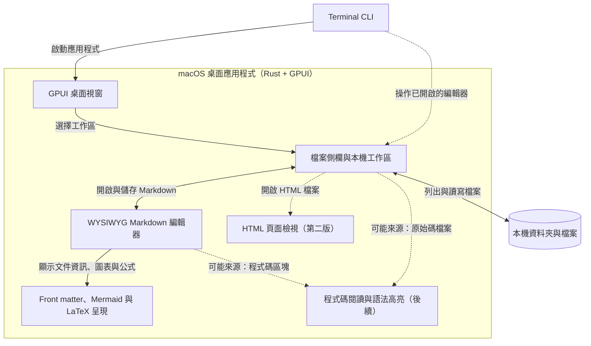

# GPUI Editor 產品需求文件

**狀態：草稿。下列首版細節與第二版界線為提案。**

第一版是用 Rust 與 GPUI 開發的 macOS 所見即所得（WYSIWYG）Markdown 編輯器。第一版可從 Terminal 啟動應用程式，再在應用程式內選擇資料夾、從側欄挑選文件，並在同一畫面編輯文字與格式。圖片、連結、front matter、Mermaid 與 LaTeX 都在文件內顯示；存檔格式仍是 Markdown。

## 使用者問題

首批試用對象提案：習慣用 Terminal、以本機 Markdown 撰寫技術筆記或專案文件的 macOS 使用者。待驗證的問題是：他們能否在同一畫面找到並修改 Markdown 文件，而不必在檔案選擇器、原始碼與預覽之間反覆切換。

## 第一版範圍（提案）

- 用暫定指令 `gpui-editor` 啟動應用程式。第一版 CLI 不接收檔案或資料夾路徑，不支援控制已開啟的編輯器。
- 在應用程式內選擇本機資料夾。視窗所開啟的資料夾稱為「工作區」。第一版使用單一視窗，一次編輯一份本機 UTF-8 `.md` 文件。
- 側欄只列出工作區最上層的 `.md` 檔案，不展開子資料夾。文件連結可開啟工作區內的子資料夾文件，但不變更側欄根資料夾。本機相對路徑以目前文件所在的資料夾為準。
- 支援新建、開啟、編輯與儲存。段落、標題、粗體、斜體與項目符號清單直接在正文操作，不必輸入 Markdown 標記。
- 下表定義正文及文件資訊的操作範圍，不承諾完整支援 CommonMark 或 GitHub Flavored Markdown。

| 項目 | 預設顯示 | 新增、修改與移除 |
| --- | --- | --- |
| YAML front matter | 在正文上方顯示檔案開頭以 `---` 包住的欄位與值。沒有 front matter 時不顯示區塊。 | 透過編輯器操作新增或移除；點一下既有區塊可就地修改 YAML。 |
| Mermaid | 將 `mermaid` 程式碼區塊顯示為圖表；第一版以流程圖為最低支援範圍。 | 透過編輯器操作新增或移除；點一下圖表可就地修改 Mermaid 語法。 |
| LaTeX | 顯示 `$...$` 行內公式與 `$$...$$` 獨立公式。 | 透過編輯器操作新增或移除；點一下公式可就地修改 LaTeX 語法。 |
| 圖片 `` | 在正文顯示圖片。 | 可新增、移除或修改圖片來源及替代文字。 |
| 連結 `[]()` | 顯示連結文字，滑鼠停留時顯示完整網址或檔案路徑，單擊開啟。 | 可新增或移除連結；透過獨立的編輯操作修改文字與目標，不用單擊連結進入編輯。 |

點到 front matter、Mermaid 或 LaTeX 項目之外時，只重新渲染剛編輯的項目，不自動存檔。第一版不做視覺化繪圖或公式排版工具，也不包含整份文件的原始碼編輯模式、多分頁、外掛、雲端同步和其他平台。

## 概念架構

架構決策：第 4 項為建議，其餘已確認。

1. **文件模型以 Markdown 原文為準。** 所見即所得的畫面根據原文顯示，存檔不從畫面重建整份文件。選擇原因與代價見 [ADR 0001](../decisions/0001-markdown-source-as-document-model.md)。
2. **整份文件共用一個編輯區。** 游標與文字選取可跨段落，不為每個區塊建立獨立編輯器。Front matter、Mermaid 與 LaTeX 點擊後仍在同一個編輯區內就地切換成原始語法，修改納入同一份文件的復原紀錄。

3. **桌面介面用 GPUI。** 視窗、側欄與編輯區都用 GPUI。Mermaid 和 LaTeX 由哪個函式庫產生顯示結果，尚未決定。
4. **本機檔案與工作區邏輯留在應用程式內（建議）。** 用同一個 Rust 程序處理檔案讀寫、工作區切換與未儲存修改，不另開後端服務。
5. **第一版 CLI 只啟動應用程式。** 選擇或切換工作區由桌面介面負責。

下圖仍是提案：實線表示第一版，虛線表示第二版或後續方向。



## 需求與驗收條件（提案）

| 需求 | 驗收條件 |
| --- | --- |
| 從 Terminal 啟動應用程式 | 應用程式未啟動時，在 Terminal 執行 `gpui-editor`，可看到桌面視窗。不需要傳入路徑，執行指令時所在的資料夾也不會自動成為工作區。 |
| 在應用程式內開啟工作區 | 從視窗選擇資料夾 A，側欄顯示 A 的文件。選擇資料夾 B 時，在原視窗切換工作區，並先處理未儲存修改；取消或存檔失敗時，工作區與編輯中的文件維持不變。 |
| 從側欄開啟檔案 | 測試資料夾最上層有兩份 `.md` 檔案，側欄均有列出；非 Markdown 檔案和子資料夾的文件不列出。依序點選兩份檔案時，編輯區會顯示各自的內容。 |
| 直接編輯已套用格式的內容 | 新建空白文件後，可用 macOS 中文輸入法輸入繁體中文，並在同一個編輯區跨兩個段落選取文字。使用者可直接將段落改成標題或項目符號清單，也可對選取文字套用或取消粗體和斜體。變更立即顯示在同一畫面，操作時不必輸入 Markdown 標記。 |
| 顯示 Markdown 圖片 | 開啟含 `` 的文件時，圖片顯示在正文中。相對路徑從目前 Markdown 文件所在的資料夾解析，而不是從側欄根資料夾解析。若圖片無法載入，顯示替代文字與提示。HTTPS 圖片預設顯示替代文字與提示，使用者選擇為目前文件載入遠端圖片後才發出請求。 |
| 查看並開啟網頁連結 | 正文中的 `[範例網站](https://example.com/docs?q=test#intro)` 顯示為「範例網站」。滑鼠停在連結上時，提示顯示完整網址，包含查詢參數與 `#` 後的片段；點一下後，使用 macOS 預設瀏覽器開啟該網址。 |
| 查看並開啟本機文件連結 | 滑鼠停在 `[使用指南](notes/guide.md)` 上時，提示顯示完整的目標檔案路徑。點一下後，在編輯器內開啟該文件，側欄仍顯示原工作區。文件切換沿用未儲存修改的保護流程。若目標不存在、不是 `.md` 或位於工作區之外，顯示提示並保留目前文件。 |
| 點擊編輯 front matter | 開啟含 YAML front matter 的 `.md` 檔案時，正文上方顯示 `title`、`tags` 等欄位與值。點一下該區塊可編輯 YAML；修改 `title` 並點回正文後，區塊恢復欄位顯示並呈現新值。只修改正文並儲存時，原始 front matter 保持不變。沒有 front matter 的文件不顯示此區塊。 |
| 點擊編輯 Mermaid 圖表 | 開啟含 `mermaid` 程式碼區塊的 `.md` 檔案時，編輯區顯示流程圖。點一下圖表可編輯 Mermaid 語法；修改節點標籤並點到圖表外後，原位置顯示更新後的流程圖。 |
| 點擊編輯 LaTeX 公式 | 開啟含 `$...$` 行內公式和 `$$...$$` 獨立公式的測試檔時，兩種公式均顯示排版結果。分別點一下公式並修改語法，再點到公式外，兩種公式都會恢復排版並顯示修改結果。 |
| 從零建立內容 | 新建空白文件後，可新增一個 front matter 區塊、一張 Mermaid 圖表、行內與獨立 LaTeX 公式、一張圖片和一個連結。可修改圖片與連結的目標，也可分別移除各項目。儲存並重開後，新增、修改或移除的結果仍在。 |
| 保留無法渲染的內容 | YAML、Mermaid 或 LaTeX 語法無法解析時，在原位置顯示錯誤提示，保留原始語法並允許點回去修正。文件其餘部分仍可繼續編輯；若使用者存檔，保留尚未修正的輸入，不以錯誤提示取代。 |
| 開啟與儲存 Markdown | 新文件首次儲存時可選擇檔名和位置。儲存須包含仍在就地編輯中的變更。檔案維持 UTF-8 Markdown；重開後可看到預期的內容和格式。 |
| 保留未編輯的 Markdown | 編輯器可重新產生已修改部分的 Markdown，但未編輯的部分必須逐字保留，不只是畫面相同。開啟含首版不支援的 GFM 表格的文件時，表格顯示為不可就地編輯的原始文字；只修改文件標題並儲存後，表格原文不變。若無法保證保留不支援的內容，顯示原因並阻止覆寫原檔。 |
| 保護未儲存的修改 | 新建、切換文件或工作區、關閉視窗或結束程式前，若有未儲存修改，提供儲存、捨棄或取消。選擇儲存時，只有存檔成功才能繼續原操作；取消操作、取消首次儲存或存檔失敗時，都留在原文件並保留修改。 |
| 顯示檔案讀寫錯誤 | 開啟不存在的檔案或儲存到沒有寫入權限的位置時，顯示錯誤，不清除目前的文件內容，也不把未儲存的修改標為已儲存。 |

### 共用驗收案例

測試工作區最上層放入 `sample.md`、`other.md`，另備 `notes/guide.md`、PNG 圖片 `images/example.png`，以及供切換使用的另一個工作區。`sample.md` 內容如下：

````markdown
---
title: 測試文件
tags: [editor]
---

# 原始標題


[使用指南](notes/guide.md)
[範例網站](https://example.com/docs?q=test#intro)


行內公式：$x^2$。

$$
x^2 + y^2 = z^2
$$

| 欄位 |  值  |
| --- | --- |
| 未編輯 |  保留  |
````

1. 從 Terminal 啟動應用程式，在視窗中選擇測試工作區，再從側欄選取 `sample.md`。修改標題並儲存，確認檔案差異只在標題一行，未改動 front matter 或表格的原始文字與空格。
2. 分別點擊並修改 front matter、圖表、行內公式和獨立公式。點到項目外後核對更新結果；儲存並重開，核對修改後的語法和顯示。
3. 修改正文但不存檔，點擊「使用指南」。先選取消，確認原文件與修改都留在原處；再選擇儲存並讓寫入失敗，核對同一結果。成功存檔後，確認開啟 `notes/guide.md`，側欄仍顯示原工作區。
4. 在仍有未儲存修改時，從應用程式選擇另一個工作區。先取消，確認原工作區與文件未變；再重試並捨棄修改，確認同一個視窗切換到新工作區。

### macOS 原生驗收

自動測試使用暫存檔案和 GPUI 模擬視窗。它驗證了共用編輯區的選取、就地修改和原文保留，以及文件切換前取消或存檔失敗時對未儲存修改的保護。模擬視窗不等同於原生 macOS 輸入或對話框；下列步驟須由具備桌面環境的操作者確認：

1. 依 [README](../../README.md#build-and-run-on-macos) 從測試工作區以外啟動 App。確認初始視窗不自動開啟目前資料夾；從原生資料夾選擇器選擇測試工作區，再從側欄開啟兩份不同文件。
2. 用繁體中文輸入法組字。在確認候選字之前嘗試存檔與關閉視窗，確認應用程式要求先完成組字、未寫入暫存文字，且視窗仍開啟。確認候選字後再存檔，核對檔案內容。捲動後檢查候選視窗位置，再拖曳跨段落選取，點擊一個公式並在原位置修改，點到項目外確認重新渲染。
3. 執行上方共用驗收案例的存檔、文件與工作區切換。確認原文比對、存檔失敗與取消皆符合預期，再用 `Cmd-Q` 和視窗關閉操作驗證未儲存修改保護。

原生互動未實測前，不宣稱第一版已通過原生驗收。試用者的完成率另外依下一節記錄。

## 成功衡量

請首批試用者在沒有操作示範的情況下，啟動應用程式、選擇資料夾、找到指定文件、改一個標題、更新一張圖表並存檔。記錄首次無提示完成率（不需要額外協助就完成全部任務的人數 ÷ 參與人數）及最常卡住的步驟。首輪用來建立基準，不用來取代存檔保留與錯誤處理等必過的功能驗收。

## 待確認

1. 試用者最常在哪一步切換工具，以及這個流程是否比他們目前的做法省事。
2. 是否擴大首版最低支援範圍，例如新增 Mermaid 圖表類型、LaTeX 語法、YAML 以外的 front matter 格式，或文件內的標題跳轉。
3. CLI 的正式指令名稱、最低支援的 macOS 版本、是否支援 Intel Mac，以及桌面程式和 CLI 的安裝方式。

## 第二版：HTML 瀏覽

第二版開始支援 HTML 瀏覽；不改變第一版的 Markdown 編輯範圍。

- **範圍提案：**側欄可開啟本機 `.html` 檔案，應用程式內顯示唯讀的靜態頁面。可載入工作區內的本機樣式表和圖片，不執行 JavaScript，也不自動載入遠端資源。
- **連結行為：**點擊工作區內的本機 `.html` 連結時，在應用程式內開啟目標頁面；點擊 HTTP 或 HTTPS 連結時，交給 macOS 預設瀏覽器。
- **驗收提案：**從側欄開啟 `index.html`。確認本機樣式與圖片正常顯示、程式碼不會動態修改頁面、遠端資源未載入，且本機與外部連結分別在正確位置開啟。瀏覽不修改原始檔案。
- Markdown 內嵌 HTML、HTML 原始碼編輯與網頁指令碼執行不納入第二版提案。

## 其他後續方向（版本待定）

- **程式碼閱讀與語法高亮：**這是獨立於 HTML 頁面瀏覽的功能，不納入第一版驗收。後續計畫依程式語言區分關鍵字、字串與註解。適用範圍待確認：Markdown 文件內的程式碼區塊、從側欄開啟的獨立原始碼檔案，或兩者都支援。優先支援的程式語言也待確認。
- **透過 CLI 操作編輯器：**第一版只要求能從 Terminal 啟動應用程式。後續可支援從 Terminal 開啟指定資料夾或檔案，或向已開啟的編輯器下指令；優先支援的操作，以及有多個視窗時如何選擇操作對象，待確認。
