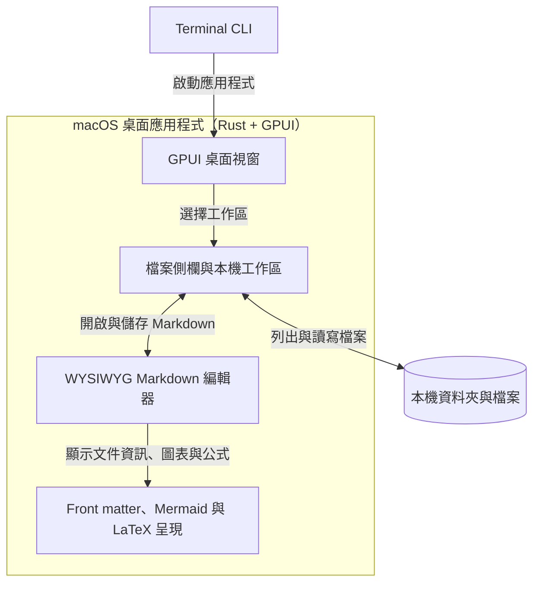

# GPUI Editor 產品需求文件

**狀態：第一版需求定稿。原生驗收結果與試用基準另行記錄；HTML 瀏覽仍為後續提案。**

GPUI Editor 是 macOS 本機 Markdown 編輯器。使用者從 Terminal 啟動應用程式，在側欄開啟文件，直接在同一個編輯區修改已套用格式的內容，不必切換到獨立預覽。這是第一版所見即所得（WYSIWYG）的範圍：段落與常用格式可直接編輯，front matter、Mermaid 與 LaTeX 顯示結果，但修改時會就地顯示語法。存檔格式仍是 Markdown。

## 使用者問題

首批試用對象是習慣使用 Terminal、以本機 Markdown 撰寫技術筆記或專案文件的 macOS 使用者。第一版要驗證他們能否在同一畫面找到並修改文件，而不用在檔案選擇器、原始碼與預覽之間反覆切換。

## 第一版範圍

- 使用已建置的 `gpui-editor` 執行檔啟動應用程式，或在專案根目錄執行 `just run`。CLI 不接收檔案或資料夾路徑，也不控制已開啟的編輯器。
- 在應用程式內選擇本機資料夾。視窗所開啟的資料夾稱為「工作區」。第一版使用單一視窗，一次編輯一份本機 UTF-8 `.md` 文件。
- 側欄只列出工作區最上層的 `.md` 檔案，不展開子資料夾。文件連結可開啟工作區內的子資料夾文件，但不變更側欄根資料夾。本機相對路徑以目前文件所在的資料夾為準。
- 支援新建、開啟、編輯與儲存。段落、標題、粗體、斜體與項目符號清單直接在正文操作，不必輸入 Markdown 標記。
- 下表定義正文及文件資訊的操作範圍，不承諾完整支援 CommonMark 或 GitHub Flavored Markdown。

| 項目 | 預設顯示 | 新增、修改與移除 |
| --- | --- | --- |
| YAML front matter | 在正文上方顯示檔案開頭以 `---` 包住的欄位與值。沒有 front matter 時不顯示區塊。 | 透過編輯器操作新增或移除；點一下既有區塊可就地修改 YAML。 |
| Mermaid | 將 `mermaid` 程式碼區塊中的平面流程圖顯示為圖表。不支援子圖或其他圖表類型。 | 透過編輯器操作新增或移除；點一下圖表可就地修改 Mermaid 語法。 |
| LaTeX | 顯示 `$...$` 行內公式與 `$$...$$` 獨立公式。行內公式不得跨段落。 | 透過編輯器操作新增或移除；點一下公式可就地修改 LaTeX 語法。 |
| 圖片 `` | 在正文顯示本機或 HTTPS 來源的 PNG、JPEG、GIF 和 WebP 靜態圖片。載入 HTTPS 圖片前須取得目前文件的載入許可。 | 可新增或移除圖片；點一下既有圖片可就地修改來源及替代文字。 |
| 連結 `` | 顯示連結文字，滑鼠停留時顯示完整網址或檔案路徑，單擊開啟。 | 可新增或移除連結；透過獨立的編輯操作修改文字與目標，不用單擊連結進入編輯。 |

點到正在編輯的項目之外時，該項目恢復預覽，不自動存檔。第一版不含視覺化繪圖、公式排版工具、整份文件的原始碼編輯模式、HTML 頁面檢視、多分頁、外掛、雲端同步或其他平台。

## 概念架構

1. **以 Markdown 原文為準。** 畫面從原文產生，存檔不從畫面重建整份文件。見 [ADR 0001](../decisions/0001-markdown-source-as-document-model.md)。
2. **整份文件共用一個編輯區。** 游標與選取可跨段落。就地語法編輯也使用同一個編輯區和復原紀錄。
3. **桌面介面用 GPUI。** Mermaid 平面流程圖由 mmdflux 渲染；LaTeX 由 Mathra 排版。
4. **同一個 Rust 程序處理檔案。** 應用程式負責檔案讀寫、工作區切換與未儲存修改，不另開後端服務。

## 需求與驗收條件

| 需求 | 驗收條件 |
| --- | --- |
| 從 Terminal 啟動應用程式 | 從測試工作區以外執行不帶參數的 `gpui-editor`。確認初始視窗、外層工具列文字、側欄與中央提示皆可見，且目前資料夾未自動成為工作區。傳入檔案或資料夾路徑時，顯示用法並拒絕啟動。 |
| 在應用程式內開啟工作區 | 從視窗選擇資料夾 A，側欄顯示 A 的文件。選擇資料夾 B 時，在原視窗切換工作區，並先處理未儲存修改；取消或存檔失敗時，工作區與編輯中的文件維持不變。重新選擇 A 時只更新側欄，保留目前文件及草稿。 |
| 從側欄開啟檔案 | 測試資料夾最上層有兩份 `.md` 檔案，側欄均有列出；非 Markdown 檔案和子資料夾的文件不列出。依序點選兩份檔案時，編輯區會顯示各自的內容。 |
| 直接編輯已套用格式的內容 | 新建空白文件後，可用 macOS 中文輸入法輸入繁體中文，並在同一個編輯區跨兩個段落選取文字。使用者可直接將段落改成標題或項目符號清單，也可對選取文字套用或取消粗體和斜體。變更立即顯示在同一畫面，操作時不必輸入 Markdown 標記。 |
| 顯示 Markdown 圖片 | 開啟含 `` 的文件時，圖片顯示在正文中。相對路徑從目前 Markdown 文件所在的資料夾解析，而不是從側欄根資料夾解析。若圖片無法載入，顯示替代文字與提示。HTTPS 圖片預設顯示替代文字與提示，使用者選擇為目前文件載入遠端圖片後才發出請求。 |
| 查看並開啟網頁連結 | 正文中的 `[範例網站](https://example.com/docs?q=test#intro)` 顯示為「範例網站」。滑鼠停在連結上時，提示顯示完整網址，包含查詢參數與 `#` 後的片段；點一下後，使用 macOS 預設瀏覽器開啟該網址。 |
| 查看並開啟本機文件連結 | 滑鼠停在 `[使用指南](notes/guide.md)` 上時，提示顯示完整的目標檔案路徑。點一下後，在編輯器內開啟該文件，側欄仍顯示原工作區。文件切換沿用未儲存修改的保護流程。若目標不存在、不是 `.md` 或位於工作區之外，顯示提示並保留目前文件。 |
| 點擊編輯 front matter | 開啟含 YAML front matter 的 `.md` 檔案時，正文上方顯示 `title`、`tags` 等欄位與值。點一下該區塊可編輯 YAML；修改 `title` 並點回正文後，區塊恢復欄位顯示並呈現新值。只修改正文並儲存時，原始 front matter 保持不變。沒有 front matter 的文件不顯示此區塊。 |
| 點擊編輯 Mermaid 圖表 | 開啟含 `mermaid` 程式碼區塊的 `.md` 檔案時，編輯區顯示流程圖。點一下圖表可編輯 Mermaid 語法；修改節點標籤並點到圖表外後，原位置顯示更新後的流程圖。 |
| 點擊編輯 LaTeX 公式 | 開啟含 `$...$` 行內公式和 `$$...$$` 獨立公式的測試檔時，兩種公式均顯示排版結果。分別點一下公式並修改語法，再點到公式外，兩種公式都會恢復排版並顯示修改結果。 |
| 從零建立內容 | 新建空白文件後，可新增一個 front matter 區塊、一張 Mermaid 圖表、行內與獨立 LaTeX 公式、一張圖片和一個連結。可修改圖片與連結的目標，也可分別移除各項目。儲存並重開後，新增、修改或移除的結果仍在。 |
| 保留無法渲染的內容 | YAML、Mermaid 或 LaTeX 語法無法解析時，在原位置顯示錯誤提示，保留原始語法並允許點回去修正。文件其餘部分仍可繼續編輯；若使用者存檔，保留尚未修正的輸入，不以錯誤提示取代。 |
| 開啟與儲存 Markdown | 新文件首次儲存時可選擇檔名和位置。若已開啟工作區，儲存位置須在工作區內；首次存檔不得覆寫既有檔案。儲存須包含仍在就地編輯中且已確認的文字。檔案維持 UTF-8 Markdown；重開後可看到預期的內容和格式。 |
| 保留未編輯的 Markdown | 編輯器可重新產生已修改部分的 Markdown，但未編輯的部分必須逐字保留，不只是畫面相同。開啟含首版不支援的 GFM 表格的文件時，表格顯示為不可就地編輯的原始文字；只修改文件標題並儲存後，表格原文不變。若無法保證保留不支援的內容，顯示原因並阻止覆寫原檔。 |
| 保護未儲存的修改 | 新建、切換文件或工作區、關閉視窗或結束程式前，若有未儲存修改，提供儲存、捨棄或取消。選擇儲存時，只有存檔成功才能繼續原操作；取消操作、取消首次儲存或存檔失敗時，都留在原文件並保留修改。 |
| 顯示檔案讀寫錯誤 | 開啟不存在的檔案或儲存到沒有寫入權限的位置時，顯示錯誤，不清除目前的文件內容，也不把未儲存的修改標為已儲存。若存檔時發現外部修改或無法驗證目的地，不回報成功；若在置換時發現其他版本，保留該版本並顯示可供復原的路徑。 |

### 共用驗收案例

在暫存資料夾建立兩個測試工作區 A 與 B，不使用原有文件。將 [sample.md](../../crates/document/tests/fixtures/sample.md) 複製到 A 根目錄，並保留一份未修改的基準副本在 A 之外。在 A 另建 `other.md`、`ignore.txt`、`notes/guide.md`，以及任一有效 PNG `images/example.png`。在 B 建立一份不同名稱的 `.md` 檔案。每個 `.md` 都應有可辨識的標題。

1. 開啟 A。確認側欄只列出 `sample.md` 與 `other.md`，且兩者都可開啟。只修改 `sample.md` 的標題並儲存，用 `diff -u` 與基準副本比對。確認只有標題一行不同，包含 front matter、粗體標記與表格空格的其他原文均未變。
2. 分別點擊並修改 front matter、流程圖以及兩種公式。點到項目外後確認預覽已更新、磁碟檔案尚未變更。再於一個項目仍在編輯時儲存並重開，核對語法與預覽。用副本分別測試無效 YAML、Mermaid 和 LaTeX，確認錯誤可見、原文可儲存且可就地修正。
3. 確認 `sample.md` 中的 PNG 顯示。在 `notes/guide.md` 加入同一相對路徑 `images/example.png`，並在 `notes/images/` 放入另一張同名 PNG。由本機連結開啟 `guide.md`，確認顯示的是 `notes` 下的圖片。將該圖片移出工作區並重開文件，核對替代文字及提示。測試 HTTPS 圖片時，使用可查閱請求紀錄的測試網址，確認許可前沒有請求，許可後才載入圖片。滑鼠停在網頁連結上時核對完整網址；點擊後確認由預設瀏覽器開啟。
4. 修改 `sample.md` 正文但不存檔。滑鼠停在「使用指南」上時核對完整路徑。點擊連結後先取消，確認原文件與草稿不變。再點擊並選擇儲存，確認開啟 `notes/guide.md`，且側欄仍指向 A。另在副本測試不存在、非 Markdown 或位於工作區之外的目標，確認提示出現且不切換文件。
5. 重開 `sample.md` 並再做一筆未存檔修改。重新選擇 A，確認側欄更新而草稿不變。選擇 B 後先取消，確認 A 與草稿不變。從外部修改 `sample.md`，重選 B 並選擇儲存，確認衝突阻止切換，草稿與磁碟上的外部版本都保留。最後重選 B 並捨棄測試草稿，確認同一視窗切換到 B，側欄不再列出 A 的檔案。
6. 新建文件並用工具列新增表列各項目，再修改圖片來源、替代文字、連結文字與目標。首次儲存先取消，確認草稿未變；再用新檔名儲存及重開，核對所有項目。依序移除各項目，再儲存及重開，確認原文與畫面均無已移除的項目。

### macOS 原生驗收

驗收分成兩部分。自動測試驗證 CLI、文件模型、讀寫、渲染函式及 GPUI 模擬視窗中的編輯流程。從專案根目錄執行 `cargo test --locked --all-targets`。下列步驟須在 macOS 桌面另行執行；模擬視窗不能取代原生輸入法、對話框及結束流程。

1. 依 [README](../../README.md#build-and-run-on-macos) 建置。從測試工作區以外啟動執行檔。確認初始視窗不自動開啟目前資料夾，工具列標籤、側欄文字和中央提示皆可見。從 **Open Folder…** 開啟原生資料夾選擇器，選擇 A，再從側欄開啟兩份文件。
2. 開啟繁體中文輸入法並組字。在確認候選字之前嘗試儲存與關閉。確認應用程式要求先完成組字、未寫入暫存文字，且視窗仍開啟。確認候選字後再儲存，核對檔案內容。捲動畫面後再次組字，確認候選視窗對準游標。拖曳選取跨兩段的文字，並測試粗體、斜體、標題與清單操作。
3. 在真正的視窗執行共用案例，確認原生選擇器、選取與點擊，以及預設瀏覽器開啟行為。分別用 `Cmd-Q` 和視窗關閉按鈕觸發未儲存提示，確認取消時草稿保留，且只有成功儲存或捨棄修改後才結束操作。

每次驗收記錄提交版本、macOS 版本、機型、檢查項目、結果及佐證。未執行的項目標記為「未驗證」，不能以模擬測試通過代替原生驗收。

2026-11-24 驗證紀錄（`1ba6f97`、Apple Silicon `Mac16,12`、macOS 26.6.2）：

- 原生啟動畫面通過。工具列文字、側欄與中央提示皆可見，未自動選擇工作區。
- 以預先載入測試文件的建置檢查原生畫面：側欄列出兩份 `.md`，編輯區顯示格式化文字、front matter、圖片、連結、流程圖及兩種公式。這項檢查未經過原生選擇器。
- 原生選擇器、輸入法及完整的互動流程未驗證。

## 成功衡量

請首批試用者在沒有操作示範的情況下，啟動應用程式、選擇資料夾、找到指定文件、改一個標題、更新一張流程圖並儲存。記錄首次無提示完成率（無額外協助即完成全部任務的人數 ÷ 參與總人數），另記錄卡住或切換工具的步驟，以及試用者與現有做法的比較。

首輪資料用來建立基準，不設通過門檻，也不替代功能驗收。目前沒有可報告的試用結果。

## 相容性與安裝

第一版提供從原始碼建置及啟動的流程，見 [README](../../README.md#build-and-run-on-macos)。目前不承諾最低 macOS 版本、Intel Mac 相容性或安裝套件。驗證過的環境不等同於最低系統需求。

## 第二版提案：HTML 瀏覽

HTML 瀏覽不屬於第一版或其驗收範圍。下列條件供後續版本評估，不代表已實作。

- **範圍提案：**側欄可開啟本機 `.html` 檔案，應用程式內顯示唯讀的靜態頁面。可載入工作區內的本機樣式表和圖片，不執行 JavaScript，也不自動載入遠端資源。
- **連結行為：**點擊工作區內的本機 `.html` 連結時，在應用程式內開啟目標頁面；點擊 HTTP 或 HTTPS 連結時，交給 macOS 預設瀏覽器。
- **驗收提案：**從側欄開啟 `index.html`。確認本機樣式與圖片正常顯示、程式碼不會動態修改頁面、遠端資源未載入，且本機與外部連結分別在正確位置開啟。瀏覽不修改原始檔案。
- Markdown 內嵌 HTML、HTML 原始碼編輯與網頁指令碼執行不納入第二版提案。

## 其他後續方向（版本待定）

- **程式碼閱讀與語法高亮：**與 HTML 瀏覽分開評估。待決定支援 Markdown 程式碼區塊、獨立原始碼檔案，或兩者皆支援；優先支援的程式語言尚未選定。
- **擴大 Markdown 支援：**評估更多 Mermaid 圖表、LaTeX 語法、YAML 以外的 front matter 格式及文件內標題跳轉。不列入第一版驗收。
- **透過 CLI 操作編輯器：**第一版只要求能從 Terminal 啟動應用程式。後續可支援從 Terminal 開啟指定資料夾或檔案，或向已開啟的編輯器下指令；優先支援的操作，以及有多個視窗時如何選擇操作對象，待確認。
