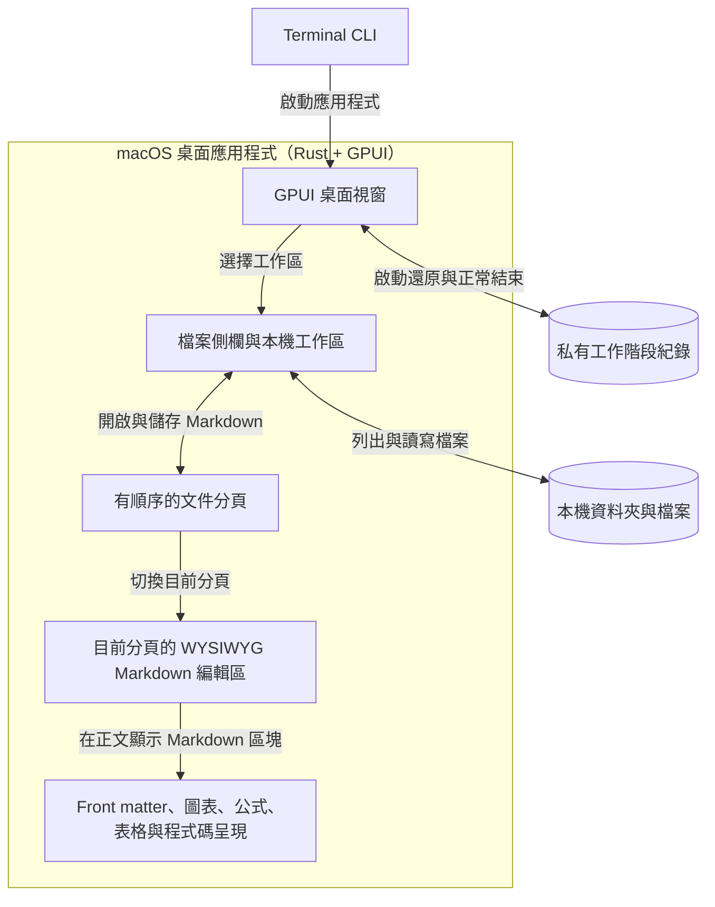

# GPUI Editor 產品需求文件

**狀態：第一版需求包含側欄分頁、多文件分頁與工作區還原。原生驗收結果、未驗證項目與試用基準另行記錄；HTML 瀏覽仍為後續提案。**

GPUI Editor 是 macOS 本機 Markdown 編輯器。使用者從 Terminal 啟動應用程式，在側欄開啟文件，直接在同一個編輯區修改已套用格式的內容，不必切換到獨立預覽。這是第一版所見即所得（WYSIWYG）的範圍：段落與常用格式可直接編輯，front matter、Mermaid 與 LaTeX 顯示結果，但修改時會就地顯示語法。存檔格式仍是 Markdown。

## 使用者問題

首批試用對象是習慣使用 Terminal、以本機 Markdown 撰寫技術筆記或專案文件的 macOS 使用者。第一版要驗證他們能否在同一畫面找到並修改文件，而不用在檔案選擇器、原始碼與預覽之間反覆切換。

## 第一版範圍

- 使用已建置的 `gpui-editor` 執行檔啟動應用程式，或在專案根目錄執行 `just run`。CLI 不接收檔案或資料夾路徑，也不控制已開啟的編輯器。
- 在應用程式內選擇本機資料夾，稱為「工作區」。單一視窗一次開啟一個工作區，可用多個分頁編輯本機 UTF-8 `.md` 文件。每個分頁保留自己的草稿、游標與復原紀錄。
- 側欄提供 **Tree**、**Recent**、**Pins**、**Outline**、**Search**，預設顯示 **Tree**。側欄分頁可拖曳排序，不影響右側文件分頁。見[側欄分頁](#側欄分頁)。
- **Tree** 以樹狀結構顯示資料夾及檔案，不追蹤 symbolic links。點選資料夾可展開或收合；點選 `.md` 檔案及工作區內的 Markdown 連結可開啟或切換文件分頁，不變更側欄根資料夾。文件內的本機相對路徑以該文件所在的資料夾為準。
- **New note** 建立獨立空白分頁；**Save** 與 `Cmd-S` 只儲存目前分頁。段落、標題、粗體、斜體與項目符號清單直接在正文操作，不必輸入 Markdown 標記。
- 正常結束後，下次啟動還原上次的工作區、仍開著的已存檔分頁，以及可還原的選取項目。未開啟工作區時單獨存檔的文件不納入還原。跨重啟不還原草稿、游標、復原紀錄、遠端圖片許可、Developer Mode 或 Pi 配對。
- 下表定義正文及文件資訊的操作範圍，不承諾完整支援 CommonMark 或 GitHub Flavored Markdown。

| 項目 | 預設顯示 | 新增、修改與移除 |
| --- | --- | --- |
| YAML front matter | 在正文上方顯示檔案開頭以 `---` 包住的欄位與值。沒有 front matter 時不顯示區塊。 | 透過編輯器操作新增或移除；點一下既有區塊可就地修改 YAML。 |
| Mermaid | 將 `mermaid` 程式碼區塊中的平面流程圖顯示為圖表。不支援子圖或其他圖表類型。 | 透過編輯器操作新增或移除；點一下圖表可就地修改 Mermaid 語法。 |
| 一般程式碼區塊 | 圍欄式及縮排式區塊以等寬字顯示程式碼，保留換行與內容縮排；不顯示圍欄、不做語法高亮。 | 唯讀；點擊可選取整個區塊，複製時取得 Markdown 原文。 |
| GFM 表格 | 顯示表頭、格線及依 Markdown 設定對齊的純文字儲存格；儲存格中的連結不具點擊功能。 | 唯讀；點擊可選取整張表格，複製時取得 Markdown 原文。 |
| LaTeX | 顯示 `$...$` 行內公式與 `$$...$$` 獨立公式。行內公式不得跨段落。 | 透過編輯器操作新增或移除；點一下公式可就地修改 LaTeX 語法。 |
| 圖片 `` | 在正文顯示本機或 HTTPS 來源的 PNG、JPEG、GIF 和 WebP 靜態圖片。載入 HTTPS 圖片前須取得目前文件的載入許可。 | 可新增或移除圖片；點一下既有圖片可就地修改來源及替代文字。 |
| 連結 `[]()` | 顯示連結文字，滑鼠停留時顯示完整網址或檔案路徑，單擊開啟。 | 可新增或移除連結；透過獨立的編輯操作修改文字與目標，不用單擊連結進入編輯。 |

點到文件中正在編輯的項目之外時，該項目恢復預覽，不自動存檔。第一版不含多視窗、同時開啟多個工作區、跨工作區的歷史分頁、右側文件分頁拖曳排序、自動存檔或當機復原，也不含視覺化繪圖、公式排版工具、整份文件的原始碼編輯模式、HTML 頁面檢視、外掛、雲端同步或其他平台。

## 概念架構

1. **以 Markdown 原文為準。** 畫面從原文產生，存檔不從畫面重建整份文件。見 [ADR 0001](../decisions/0001-markdown-source-as-document-model.md)。
2. **每份文件有自己的編輯區。** 同一份文件的游標與選取可跨段落。就地語法編輯使用該分頁的編輯區和復原紀錄。已存檔文件以正規化路徑辨識，不以檔名或內容比對。
3. **桌面介面用 GPUI。** Mermaid 平面流程圖由 mmdflux 渲染；LaTeX 由 Mathra 排版。
4. **同一個 Rust 程序處理檔案。** 應用程式負責檔案讀寫、工作區切換與未儲存修改，不另開後端服務。
5. **工作階段紀錄與文件分開。** 應用程式在背景讀寫 `~/Library/Application Support/GPUI Editor/session.json`，不寫入工作區。私有且有版本的紀錄只存工作區根路徑和檔案系統識別、分頁相對路徑和順序、目前已存檔分頁的路徑，不存原文、草稿或配對資料。正常結束通過未儲存檢查後才以原子方式更新紀錄。



## 需求與驗收條件

| 需求 | 驗收條件 |
| --- | --- |
| 從 Terminal 啟動應用程式 | 沒有工作階段紀錄時，從測試工作區以外執行不帶參數的 `gpui-editor`。確認初始視窗的側欄控制項、編輯器工具列與中央提示皆可見，且目前資料夾未自動成為工作區。傳入檔案或資料夾路徑時，顯示用法並拒絕啟動。 |
| 在應用程式內開啟工作區 | 選擇資料夾 A，側欄顯示 A 的文件。重新選擇 A 時只更新側欄，保留所有分頁、選取及草稿。選擇資料夾 B 時，先依分頁順序處理 A 的草稿，成功後才在原視窗切換工作區。 |
| 從側欄開啟並切換分頁 | 側欄列出資料夾及檔案。展開子資料夾，確認可開啟其中的 `.md`，而非 Markdown 檔案不會開啟。分別開啟兩份文件並修改、切換，確認不詢問是否儲存，各分頁保留草稿、游標與復原紀錄。再次開啟同一路徑時選取既有分頁，不覆寫草稿。 |
| 辨識及關閉分頁 | 分頁列顯示目前分頁、檔名及未儲存標記；可用相對路徑辨識同名文件。分頁太多時可水平捲動，選取的分頁仍可見；視窗縮至 `560×360` 時仍可編輯。點分頁的關閉按鈕不先選取該分頁；`Cmd-W` 關閉目前分頁。關閉目前分頁後先選右側，沒有右側才選左側。最後一個分頁關閉後保留工作區與側欄；沒有分頁時 `Cmd-W` 才關窗。 |
| 直接編輯已套用格式的內容 | 新建空白文件後，可用 macOS 中文輸入法輸入繁體中文，並在同一個編輯區跨兩個段落選取文字。使用者可直接將段落改成標題或項目符號清單，也可對選取文字套用或取消粗體和斜體。變更立即顯示在同一畫面，操作時不必輸入 Markdown 標記。 |
| 顯示 Markdown 圖片 | 開啟含 `` 的文件時，圖片顯示在正文中。相對路徑從目前 Markdown 文件所在的資料夾解析，而不是從側欄根資料夾解析。若圖片無法載入，顯示替代文字與提示。HTTPS 圖片預設顯示替代文字與提示，使用者選擇為目前文件載入遠端圖片後才發出請求。 |
| 查看並開啟網頁連結 | 正文中的 `[範例網站](https://example.com/docs?q=test#intro)` 顯示為「範例網站」。滑鼠停在連結上時，提示顯示完整網址，包含查詢參數與 `#` 後的片段；點一下後，使用 macOS 預設瀏覽器開啟該網址。 |
| 查看並開啟本機文件連結 | 滑鼠停在 `[使用指南](notes/guide.md)` 上時，提示顯示完整的目標檔案路徑。點一下後開啟新分頁或選取既有分頁，不詢問是否儲存，側欄仍顯示原工作區。若目標不存在、不是 `.md` 或位於工作區之外，顯示提示並保留目前分頁及草稿。 |
| 點擊編輯 front matter | 開啟含 YAML front matter 的 `.md` 檔案時，正文上方顯示 `title`、`tags` 等欄位與值。點一下該區塊可編輯 YAML；修改 `title` 並點回正文後，區塊恢復欄位顯示並呈現新值。只修改正文並儲存時，原始 front matter 保持不變。沒有 front matter 的文件不顯示此區塊。 |
| 點擊編輯 Mermaid 圖表 | 開啟含 `mermaid` 程式碼區塊的 `.md` 檔案時，編輯區顯示流程圖。點一下圖表可編輯 Mermaid 語法；修改節點標籤並點到圖表外後，原位置顯示更新後的流程圖。 |
| 點擊編輯 LaTeX 公式 | 開啟含 `$...$` 行內公式和 `$$...$$` 獨立公式的測試檔時，兩種公式均顯示排版結果。分別點一下公式並修改語法，再點到公式外，兩種公式都會恢復排版並顯示修改結果。 |
| 從零建立內容 | 新建空白文件後，可新增一個 front matter 區塊、一張 Mermaid 圖表、行內與獨立 LaTeX 公式、一張圖片和一個連結。可修改圖片與連結的目標，也可分別移除各項目。儲存並重開後，新增、修改或移除的結果仍在。 |
| 保留無法渲染的內容 | YAML、Mermaid 或 LaTeX 語法無法解析時，在原位置顯示錯誤提示，保留原始語法並允許點回去修正。文件其餘部分仍可繼續編輯；若使用者存檔，保留尚未修正的輸入，不以錯誤提示取代。 |
| 開啟與儲存 Markdown | 可同時開啟兩個未命名分頁（`Untitled.md`），**Save** 或 `Cmd-S` 只儲存目前分頁。首次儲存可選擇檔名和位置，不得覆寫既有檔案；若已開啟工作區，位置須在工作區內。首次儲存後，從側欄開啟同一文件會選取原分頁。儲存須包含仍在就地編輯中且已確認的文字。檔案維持 UTF-8 Markdown；重開後可看到預期的內容和格式。 |
| 顯示唯讀表格與程式碼 | 開啟含 GFM 表格及一般程式碼區塊的文件。表格顯示表頭、欄位對齊與格線；程式碼顯示等寬字、換行與縮排；兩者均不顯示 Markdown 分隔語法。點擊個別區塊並嘗試輸入，確認區塊不變；複製時取得原文。 |
| 保留未編輯的 Markdown | 編輯器可重新產生已修改部分的 Markdown，但未編輯的部分必須逐字保留，不只是畫面相同。只修改文件標題並儲存後，表格和程式碼區塊原文不變。若無法保證保留不支援的內容，顯示原因並阻止覆寫原檔。 |
| 保護未儲存的修改 | 關閉單一分頁只檢查該分頁；切換到不同工作區、使用視窗關閉按鈕、**Close Window** 或 `Cmd-Q` 則依分頁順序檢查所有草稿。每份草稿提供 **Save**、**Don’t Save**、**Cancel**。整個操作成功前不捨棄草稿或移除分頁。若取消操作、取消首次儲存或存檔失敗，回到操作前的分頁；已成功存檔的文件保持已儲存，其餘草稿及分頁仍保留。提示及寫入期間，不允許編輯或切換來改變操作目標；組字中的文字不得繞過既有的保護。 |
| 啟動時還原工作區及分頁 | 先顯示視窗，再從磁碟讀取上次工作階段中仍開著的已存檔文件，保留其順序及原選取分頁。遺失、重複、無法開啟或超出工作區的分頁跳過；若原選取分頁無法還原，選第一個可用分頁。若沒有可用分頁，只顯示工作區。工作區根資料夾不存在、無法存取或已被另一資料夾取代時，提示重選工作區。沒有紀錄時顯示初始畫面；損毀或不支援的紀錄不妨礙手動選擇。 |
| 處理工作階段寫入失敗 | 取消結束不變更上次紀錄。寫入失敗時保留舊紀錄，並提供 **Keep Window Open**（留在視窗）與 **Quit Without Updating**（不更新紀錄直接結束）。 |
| 顯示檔案讀寫錯誤 | 開啟不存在的檔案或儲存到沒有寫入權限的位置時，顯示錯誤，不清除目前的文件內容，也不把未儲存的修改標為已儲存。若存檔時發現外部修改或無法驗證目的地，不回報成功；若在置換時發現其他版本，保留該版本並顯示可供復原的路徑。 |

### 共用驗收案例

先確認測試版使用隔離的工作階段位置（見下方原生交接）。在暫存資料夾建立兩個測試工作區 A 與 B，不使用原有文件。將 [sample.md](../../crates/document/tests/fixtures/sample.md) 複製到 A 根目錄，並保留一份未修改的基準副本在 A 之外。在 A 另建 `other.md`、`ignore.txt`、`notes/guide.md`，以及任一有效 PNG `images/example.png`。在 B 建立一份不同名稱的 `.md` 檔案。每個 `.md` 都應有可辨識的標題。

1. 開啟 A。確認側欄可開啟 `sample.md` 與 `other.md`，並可展開 `notes` 以開啟 `guide.md`。收合及重新開啟側欄後，確認資料夾展開狀態及選取分頁不變。只修改 `sample.md` 的標題並儲存，用 `diff -u` 與基準副本比對。確認只有標題一行不同，包含 front matter、粗體標記、表格空格與程式碼圍欄的其他原文均未變。
2. 分別點擊並修改 front matter、流程圖以及兩種公式。點到項目外後確認預覽已更新、磁碟檔案尚未變更。再於一個項目仍在編輯時儲存並重開，核對語法與預覽。用副本分別測試無效 YAML、Mermaid 和 LaTeX，確認錯誤可見、原文可儲存且可就地修正。
3. 確認 `sample.md` 中的 PNG 顯示。在 `notes/guide.md` 加入同一相對路徑 `images/example.png`，並在 `notes/images/` 放入另一張同名 PNG。由本機連結開啟 `guide.md`，確認顯示的是 `notes` 下的圖片。將該圖片移出工作區並重開文件，核對替代文字及提示。測試 HTTPS 圖片時，使用可查閱請求紀錄的測試網址，確認許可前沒有請求，許可後才載入圖片。滑鼠停在網頁連結上時核對完整網址；點擊後確認由預設瀏覽器開啟。
4. 修改 `sample.md` 正文但不存檔。滑鼠停在「使用指南」上時核對完整路徑。點擊連結，確認不詢問是否儲存，直接開啟或切換到 `notes/guide.md` 的分頁，側欄仍指向 A。從側欄重選 `sample.md`，確認未增加分頁且草稿仍在。另在副本測試不存在、非 Markdown 或位於工作區之外的目標，確認提示出現且分頁和草稿不變。
5. 也修改 `other.md`，保持它為目前分頁。重新選擇 A，確認只更新側欄。選擇 B，對 `sample.md` 選 **Don’t Save**，再對 `other.md` 選 **Cancel**；確認回到 `other.md` 且兩份草稿都還在。從外部修改 `sample.md`，重選 B 並對 `sample.md` 選 **Save**，確認衝突阻止切換，草稿與磁碟上的外部版本都保留。最後重選 B 並捨棄兩份測試草稿，確認同一視窗切換到 B，側欄不再列出 A 的檔案。
6. 用 **New note** 建立兩個空白分頁。在一個分頁用工具列新增可編輯的表列項目，再修改圖片來源、替代文字、連結文字與目標。首次儲存先取消，確認兩個分頁都還在且草稿未變。再用新檔名儲存，確認只寫入目前分頁，從側欄點該檔則回到原分頁。將滑鼠停在主要工具列圖示上，確認顯示功能名稱。用三點按鈕展開或收合 **More tools**。依序移除各項目，再儲存及重開，確認原文與畫面均無已移除的項目。

### 兩欄介面原生驗收

1. 啟動測試版，確認側欄與編輯器填滿視窗，沒有獨立標題列、全域工具列或底部狀態列。確認分頁列、編輯器工具列、文件依序顯示。
2. 拖動分隔線調整側欄寬度，再收合及展開側欄。以 `Cmd-Option-S` 重複切換，確認文件、側欄分頁選取與順序、樹狀狀態和原先寬度保留。
3. 將視窗縮至 `560×360`，側欄縮至 `184 px`。確認五個側欄分頁圖示均可操作並有名稱提示。分別捲動目前側欄視圖、文件、文件分頁與編輯器工具列，確認彼此不影響，側欄工具列與分頁列保持在上方。確認段落重新換行、工具列不換行、圖示不重疊。
4. 拖曳頂端空白處移動視窗。測試 macOS 的最小化、放大或全螢幕、調整大小及關閉，確認按鈕不遮住文件分頁和側欄控制項。未儲存的分頁仍依關閉流程要求確認。
5. 在 macOS 淺色及深色外觀核對選取狀態、工具提示、文件文字與預覽的辨識度。

### Developer Mode 原生驗收

用測試文件和不含敏感資料的測試圖片驗證。從此 repository 啟動 Pi 並允許載入專案 extension；要測圖片傳送，使用支援圖片的 model。

1. 重新啟動編輯器，確認箭靶預設隱藏。在 **Preferences…** 開啟 **Developer Mode**，確認右上角顯示帶箭靶的 **Select element** 按鈕，但尚無法選取元件。
2. 在 Pi 執行 `/gpui-pair`，比對兩邊的配對碼。先拒絕，確認 Pi 無法讀取診斷，接著重試並同意。關閉 Preferences，確認箭靶可用。
3. 修改測試文件但不存檔。用箭靶選取 **Save**，確認未存檔；取消並核對 Pi 未收到訊息。再次選取並輸入文字。用 **Capture Window** 核對只擷取編輯器視窗，不含重疊視窗或桌面。若系統拒絕權限，確認仍可貼圖或只送文字。使用 **Paste Image** 附上另一張測試圖，核對預覽和移除操作。
4. 送出文字及圖片，在配對的 Pi session 核對元件、文字與附件。用 `gpui_editor_logs` 核對近期診斷中不含測試文件文字或路徑。切換 Pi session 或停用 Developer Mode 後，確認原連線無法再讀取診斷。

### macOS 原生驗收

自動測試涵蓋 CLI、文件模型、讀寫、渲染函式及 GPUI 模擬視窗中的流程。從專案根目錄執行 `cargo test --locked --all-targets`。模擬視窗不能取代 macOS 原生輸入法、對話框、結束流程或實際操作的可用性檢查。

每次原生驗收記錄測試版的提交版本（含未提交修改）、macOS 版本、機型、檢查項目、結果及佐證。未執行的項目標記為「未驗證」。

#### 表格與程式碼：原生交接

**狀態：尚無原生桌面驗收結果。** 使用隔離的測試工作階段，在 `sample.md` 核對表頭、格線、靠右對齊的值，以及程式碼的等寬字與縮排。點擊兩個區塊後分別複製，貼到外部文字編輯器比對 Markdown 原文。在測試副本加長一行程式碼及一格表格文字；縮窄視窗後確認可水平捲動看到行尾及最右欄。修改標題並儲存，以共用案例的比對方式確認兩個區塊原文不變。

#### 歷史驗證紀錄

2026-11-24 驗證紀錄（`1ba6f97`、Apple Silicon `Mac16,12`、macOS 26.6.2）：

- 原生啟動畫面通過。工具列文字、側欄與中央提示皆可見，未自動選擇工作區。
- 以預先載入測試文件的建置檢查原生畫面：側欄列出兩份 `.md`，編輯區顯示格式化文字、front matter、圖片、連結、流程圖及兩種公式。這項檢查未經過原生選擇器。
- 原生選擇器、輸入法及完整的互動流程未驗證。

#### 多文件分頁與工作區還原：原生交接

**狀態：尚無此功能的原生驗收結果。** 上方歷史紀錄不涵蓋分頁或工作階段還原。

- 建置驗證：`cargo build --locked -p gpui-editor` 在 Apple Silicon（`Mac14,2`、arm64）、macOS 26.4.1（25E253）、Xcode 26.6（17F113）、Rust 1.95.0 通過。`file target/debug/gpui-editor` 回報 arm64 Mach-O 執行檔。此結果只驗證建置，不驗證視窗操作。
- 權限預檢：`AXIsProcessTrusted()` 與 `CGPreflightPostEventAccess()` 均回傳 `false`；未要求新權限，也未啟動應用程式或注入桌面輸入。預檢不屬於功能驗收。

前提：由能操作 macOS 桌面的驗收者使用依 [README](../../README.md#build-and-run-on-macos) 建置的執行檔、已啟用的繁體中文輸入法，以及共用案例的暫存工作區 A 與 B。啟動前先核對該建置實際讀寫的工作階段路徑，確認首次與後續啟動均使用同一個隔離位置，但與正式紀錄完全分開。無法確認隔離時，不啟動；不讀取、移動、刪除或改寫正式紀錄。應用程式啟動時會要求成為前景程式，不自動啟動或操作使用中的桌面，也不要求或觸發新的系統權限；需要權限才能做的項目維持未驗證。

隔離方式（經程式碼核對，尚未在原生桌面實測）：`crates/app/src/app/session.rs` 使用 `std::env::home_dir()` 取得家目錄。此工具鏈在 macOS 優先採用非空的 `HOME`。應用程式只接受絕對路徑，再接上 `Library/Application Support/GPUI Editor/session.json`。先確認待測建置仍使用這個解析方式。背景啟動選項不能阻止應用程式要求將視窗帶到前景，也不能代替桌面隔離。

僅由驗收者在獨立測試桌面或經協調後執行。將範例中的執行檔路徑換成待測建置，不帶任何路徑參數：

```sh
test_home="$(mktemp -d /private/tmp/gpui-editor-test-home.XXXXXX)" &&
  env HOME="$test_home" /absolute/path/to/gpui-editor
```

首次正常結束後，在同一個 shell 以相同的 `test_home` 再執行 `env HOME="$test_home" /absolute/path/to/gpui-editor`。若未成功建立暫存目錄，不執行。只查看此暫存目錄下的工作階段紀錄；不修改正式位置，也不把測試紀錄複製回去。

1. **首次啟動與分頁。** 使用尚無紀錄的隔離位置，從 A 與 B 以外啟動。確認初始畫面不開啟目前資料夾，工具列、側欄與中央提示皆可讀；用 **Open Folder…** 的原生選擇器開啟 A。完成共用案例中的開啟及切換操作，核對兩份草稿、游標與復原紀錄各自保留，焦點回到目前的編輯區。加開同名文件和更多分頁；縮小視窗至 `560×360`，檢查相對路徑能辨識同名文件、分頁可捲動、目前分頁可見且仍能編輯。其他共用案例仍需在原生視窗核對點擊、選取及預設瀏覽器行為。
2. **單分頁與整個視窗的關閉。** 點非目前分頁的關閉按鈕，確認沒有誤選。用 `Cmd-W` 關閉目前分頁，確認只提示該分頁、取消保留草稿、成功關閉後依右再左選取。關閉最後一個分頁後，確認仍可用側欄；在無分頁時再次按 `Cmd-W` 才關窗。重啟應只還原工作區。另測 **Close Window**、視窗關閉按鈕及 `Cmd-Q`，確認都檢查非目前分頁的草稿。對第一份草稿選 **Don’t Save**、對後一份選 **Cancel**，確認所有草稿及原選取都保留。另試先成功存一份再取消，確認已寫入的內容保持已存檔。
3. **輸入法與焦點。** 組字未確認時，嘗試切換分頁、存檔、`Cmd-W`、點視窗關閉按鈕及 `Cmd-Q`。確認沒有丟失組字，未寫入暫存文字，也未繞過未儲存保護。確認候選字後再存，核對檔案內容；捲動後再組字，核對候選視窗對準游標。拖曳跨段落選取並執行格式操作，核對焦點和選取。
4. **正常結束與再次啟動。** 保留兩個以上的已存檔分頁、修改其中一份且不儲存，另建立一份未命名草稿。切回非第一個的已存檔分頁，再正常結束並選擇捨棄這些草稿。以同一隔離位置啟動，確認從磁碟讀取已存檔內容、分頁順序和選取皆正確，未命名分頁及捨棄的文字不回來。另測退出前在提示中首次儲存的分頁會還原。測試缺檔時，正常結束前選取非第一個的已存檔分頁，結束後從測試工作區移出該文件；重啟應跳過缺檔並選第一個可用分頁。另用暫存資料夾測試工作區根目錄失效時提示重選。
5. **未完成結束及紀錄錯誤。** 在隔離紀錄已有快照時，取消結束並核對快照未變。只在隔離位置模擬紀錄無法讀取或格式不支援，確認仍可手動選擇工作區。若能安全模擬工作階段寫入失敗，核對可留在視窗或不更新紀錄直接結束，且舊紀錄未被置換。

目前未驗證：新功能的原生開啟、分頁切換與溢位、關閉與儲存提示、焦點及實際輸入法、正常結束後再次啟動及錯誤處理。取得實測後，在此段逐項記錄實際結果；只提供畫面時，不把畫面未顯示的操作列為通過。

#### 側欄分頁：原生交接

**狀態：未驗證。** 驗收時記錄測試建置的 commit、未提交修改（若有）、macOS 版本、機型、各案例結果及佐證。GPUI 模擬測試不代替原生結果。

只在獨立測試桌面或經協調後操作。使用上方的隔離 `HOME` 啟動方式及暫存工作區 A、B；啟動前先核對待測建置的工作階段路徑，確認不讀寫正式紀錄。無法確認隔離時，不啟動。

1. 執行「兩欄介面原生驗收」。在 `560×360` 的淺色與深色外觀下核對五個分頁、名稱提示、視窗控制和分隔線。拖曳側欄分頁，核對插入線與放開位置；確認不誤觸分隔線或改變文件選取，並記錄原生拖曳手感。
2. 在 **Tree** 與 **Pins** 分別以滑鼠停留及 `Tab`／`Shift-Tab` 顯示釘選或移除控制項。按 `Enter` 或 `Space` 操作，再按 `Esc` 返回編輯區。確認操作不開啟、關閉或刪除文件。
3. 在 **Search** 貼上文字，並用繁體中文輸入法編輯查詢。按 `Enter` 確認候選字時不送出，完成組字後再按 `Enter` 才搜尋。核對檔名與內容結果、內容定位及過時提示；回到文件繼續編輯，確認焦點與草稿未丟失。依側欄驗收案例檢查隱藏、工作區切換與重新啟動。

原生拖曳、外觀、輸入法及焦點均待實測。不執行發布。

## 成功衡量

請首批試用者在沒有操作示範的情況下，啟動應用程式、選擇資料夾、找到指定文件、改一個標題、更新一張流程圖並儲存。記錄首次無提示完成率（無額外協助即完成全部任務的人數 ÷ 參與總人數），另記錄卡住或切換工具的步驟，以及試用者與現有做法的比較。

首輪資料用來建立基準，不設通過門檻，也不替代功能驗收。目前沒有可報告的試用結果。

## 相容性與安裝

第一版提供從原始碼建置及啟動的流程，見 [README](../../README.md#build-and-run-on-macos)。目前不承諾最低 macOS 版本、Intel Mac 相容性或安裝套件。驗證過的環境不等同於最低系統需求。

## 側欄分頁

側欄工具列下方依序顯示 **Tree**、**Recent**、**Pins**、**Outline**、**Search**。預設選取 **Tree**，一次只顯示一個視圖，並以強調色標示選取。各視圖獨立捲動。側欄最窄為 `184 px`，五個分頁均以帶名稱提示的圖示顯示；空間足夠時顯示文字。

可在側欄分頁列內拖曳調整順序，拖曳時顯示插入線，只在同一列內放開才更新順序。切換或拖曳側欄分頁不切換、關閉、儲存或重排文件分頁。

側欄選取、順序及寬度屬於視窗；隱藏再展開或切換工作區後保留。**Recent**、**Pins**、搜尋查詢與結果屬於目前工作區；切換視圖、隱藏側欄、重選同一工作區或取消工作區切換時保留，僅在成功切換至不同工作區後清空。重啟後側欄回到預設，不變更 `session.json` 格式或文件分頁的還原行為。

| 分頁 | 用途與行為 |
| --- | --- |
| **Tree** | 展開或收合資料夾，點選 Markdown 檔案以開啟或切換文件分頁。滑鼠停在 Markdown 檔案列或該列有鍵盤焦點時，顯示釘選或取消釘選的控制項；操作不開啟文件。 |
| **Recent** | 依成功開啟的時間列出最近 50 個不同的正規化路徑。由連結或側欄開啟並重用既有分頁也算；切換右側文件分頁、啟動還原、首次存檔及失敗或被阻止的開啟不算。 |
| **Pins** | 關閉文件分頁後仍可從清單重新開啟。滑鼠停在列上或該列有鍵盤焦點時可移除釘選，不關閉文件分頁或刪除檔案。**Pins** 與 **Recent** 均以工作區相對路徑區分同名文件，並重用既有開啟流程。 |
| **Outline** | 依 Markdown 標題層級顯示目前草稿的大綱，包含未命名文件。點選標題只捲動目前文件，不改變游標、選取、草稿或復原紀錄；組字中不跳轉。 |
| **Search** | 按 `Enter` 送出區分大小寫的單行字面查詢；組字中不送出。只搜尋目前工作區磁碟上的 UTF-8 `.md` 檔名及內容，不查草稿、不取代、不建立索引。檔名結果只開啟文件；內容結果顯示相對路徑、行號及文字片段，每行只列第一筆。內容位置仍符合目前文件時才定位，否則保留草稿並提示重新搜尋。 |

搜尋不追蹤 symbolic links，不進入 `.gpui-save-*`；每檔最多讀取 `1 MiB`，每次最多掃描 10,000 個目錄項目、顯示 200 筆結果，並保留最多 `8 MiB` 的命中行原文供跳轉時核對。依相對路徑及行序顯示。略過檔案或截斷時顯示提示，工作區根目錄無法存取與查無結果分開顯示。修改查詢或切換至不同工作區後，不接受舊搜尋的晚到結果。

### 側欄分頁驗收條件

1. 在最窄側欄依序選取五個分頁，確認只有目前視圖可見。未選工作區、未開文件、沒有標題、沒有最近紀錄或釘選，以及尚未搜尋、空白查詢或找不到結果時，確認顯示對應提示。展開資料夾並捲動 **Tree**；切到另一視圖再返回或隱藏再展開時，確認原有展開狀態及捲動位置不變。
2. 保持 **Tree** 選取，將 **Search** 拖到首位再向後拖。確認插入線、放開後的順序與原選取。另測放到列外及右側文件分頁列，確認不改順序。所有操作均不改文件分頁、草稿或存檔狀態。
3. 開啟同名但路徑不同的文件、重開有草稿的文件，再嘗試開啟不存在的檔案。確認 **Recent** 依成功開啟時間排序、去重、區分路徑且不覆寫草稿。開啟超過 50 份時只保留最近 50 份。在 **Tree** 以滑鼠或鍵盤焦點釘選後關閉文件分頁，確認可由 **Pins** 重開；在 **Pins** 移除後，核對文件分頁與檔案仍在。
4. 在未命名草稿輸入 ATX 與 Setext 標題、同名標題與多位元文字，並在程式碼圍欄內加入假標題。編輯、復原、切換文件後確認 **Outline** 只列真正的目前標題。點選目前可見範圍外的標題，確認只捲動文件。
5. 搜尋巢狀 `.md` 的檔名與內容，核對大小寫、相對路徑、行號與片段。確認不命中只存在於草稿的文字；點選內容結果前改動草稿中符合的原文，確認提示過時且不猜測位置或丟失草稿。若目標檔案已移除，確認顯示提示且不跳轉。驗證略過及截斷提示、無法存取的根目錄，並在前次搜尋未完成時修改查詢或切換工作區，確認晚到結果不覆蓋目前視圖。
6. 設定非預設的側欄選取、順序及寬度，加入 **Recent**、**Pins** 和搜尋結果。重選 A 或取消切換至 B 時確認全部保留；成功切換至 B 後確認只保留視窗層級設定。正常結束後重啟，確認側欄回到預設，已存檔的文件分頁仍依原有規則還原。

## 第二版提案：HTML 瀏覽

HTML 瀏覽不屬於第一版或其驗收範圍。下列條件供後續版本評估，不代表已實作。

- **範圍提案：**側欄可開啟本機 `.html` 檔案，應用程式內顯示唯讀的靜態頁面。可載入工作區內的本機樣式表和圖片，不執行 JavaScript，也不自動載入遠端資源。
- **連結行為：**點擊工作區內的本機 `.html` 連結時，在應用程式內開啟目標頁面；點擊 HTTP 或 HTTPS 連結時，交給 macOS 預設瀏覽器。
- **驗收提案：**從側欄開啟 `index.html`。確認本機樣式與圖片正常顯示、程式碼不會動態修改頁面、遠端資源未載入，且本機與外部連結分別在正確位置開啟。瀏覽不修改原始檔案。
- Markdown 內嵌 HTML、HTML 原始碼編輯與網頁指令碼執行不納入第二版提案。

## 後續提案：文件分頁拖曳排序（版本待定）

允許使用者在編輯器上方的文件分頁列拖曳分頁，調整同一視窗內的順序。拖曳時顯示插入位置；放開後只更新順序，不切換目前文件、不觸發存檔，也不改變任何分頁的草稿、游標或復原紀錄。

**驗收提案：**開啟三份文件，拖曳非目前分頁至第一個位置，確認順序已更新且目前文件不變。分頁超出可見範圍時，確認可將分頁拖到原本看不到的位置。正常結束後重啟，確認仍可還原的已存檔文件依新順序顯示。

## 後續提案：Command Palette（版本待定）

在編輯器視窗按 `Cmd-P` 開啟 Command Palette（指令欄），並將焦點移至搜尋欄。輸入關鍵字可篩選現有指令，例如 **Open Folder…**、**New note**、**Save** 和 **Toggle Sidebar**。使用方向鍵選取、按 `Enter` 執行，或按 `Esc` 關閉並回到原本的焦點。

沿用各指令原有的可用條件與確認流程。例如，沒有文件時不可執行 **Save**；開啟或取消指令欄不會改動文件。指令欄搜尋的是指令，不是側欄 **Search** 所搜尋的檔名和文件內容。

**驗收提案：**在文件編輯區按 `Cmd-P`，輸入 `save` 並用鍵盤執行，確認只儲存目前文件。再次開啟後按 `Esc`，確認未執行任何指令且焦點回到編輯區。

## 其他後續方向（版本待定）

- **程式碼語法高亮與獨立原始碼檔案：**一般 Markdown 程式碼區塊已納入唯讀渲染。語法高亮、獨立原始碼檔案及優先支援的程式語言另行評估。
- **擴大 Markdown 支援：**評估更多 Mermaid 圖表、LaTeX 語法與 YAML 以外的 front matter 格式。不列入第一版驗收。
- **透過 CLI 操作編輯器：**第一版只要求能從 Terminal 啟動應用程式。後續可支援從 Terminal 開啟指定資料夾或檔案，或向已開啟的編輯器下指令；優先支援的操作，以及有多個視窗時如何選擇操作對象，待確認。
